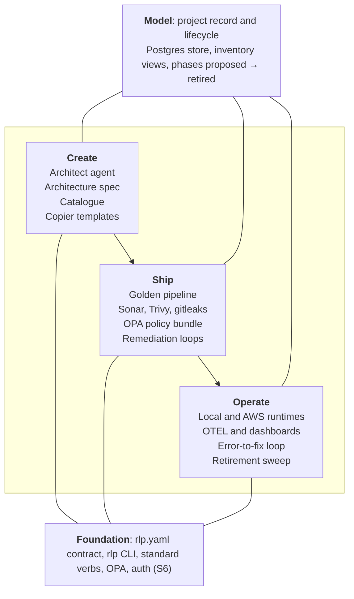

# rlp — Platform Plan

Reference half of the rlp plan (as of 2026-10-16). Execution is tracked in [GitHub Issues](https://github.com/rdlucas2/rlp/issues): one epic per slice milestone, with child issues under each.

## How to use this doc

This is the single living plan for rlp. Every section whose heading starts with a tag like `[S0]` or `[EPIC S1]` becomes exactly one GitHub issue in the `rdlucas2/rlp` repo; everything above the first epic is reference material that goes in the repo as `docs/PLAN.md`.

**Issue section format.** Each issue section follows the same shape so it can be converted mechanically:

1. Heading = issue title, prefixed with its tag
2. A metadata line: **Labels**, **Milestone**, **Depends on**
3. **Summary**: one or two sentences on the outcome
4. **Context**: why it exists and what it touches
5. **Tasks**: a `- [ ]` checklist (becomes the issue's task list)
6. **Acceptance criteria**: objective, checkable conditions; these double as the verifier when an agent loop works the issue
7. **Out of scope**: what this issue deliberately does not do

**Labels.**

| Group | Labels |
| --- | --- |
| Type | `type:epic`, `type:feature`, `type:chore` |
| Slice | `slice:0` through `slice:6` |
| Area | `area:schema`, `area:policy`, `area:cli`, `area:templates`, `area:pipeline`, `area:runtime`, `area:infra`, `area:platform`, `area:agent`, `area:observability`, `area:auth` |

**Milestones.** One per slice: `S0 Vertical slice`, `S1 Remediation loops`, `S2 Platform core`, `S3 Architect and catalogue`, `S4 Observability`, `S5 Template ecosystem`, `S6 Auth and RBAC`.

**Ordering rule.** Later slices are written as epics with a child checklist. Each epic is broken into individual issue sections here before its slice starts, so the doc stays the source of truth and the repo stays in sync with it.

## Vision and principles

rlp is an open-source, agent-native internal developer platform: it takes a project from idea to architecture, scaffolded code, gated pipeline, deployment, monitoring and retirement, and it uses agent loops to fix what its own gates find. It starts single-user and AWS-only; multi-user RBAC and other clouds come later.

**Principles.**

- **Contract over convention.** Nothing in rlp knows how to build, test or run an app. It reads the `rlp.yaml` contract and calls standard verbs. New languages arrive as templates, not platform code.
- **Runs anywhere, identically.** rlp itself, every generated app (including Lambda zips) and every pipeline run locally and in AWS. Locally, everything runs in a container. Pipelines are testable with `act`.
- **The CLI is the engine.** The `rlp` CLI executes verbs, validates contracts and drives the API. GitHub Actions workflows stay thin wrappers around `rlp` calls, so local runs and CI runs execute the same commands.
- **Verifiers the agent can't edit.** Every agent loop is judged by gates it cannot weaken: quality config, suppressions and exception files are off-limits to agent-authored changes.
- **Git is the source of truth for repos; Postgres for the platform.** Repo contracts live in repos. Project records, lifecycle and (later) users and roles live in rlp's Postgres store.
- **Escalate, don't loop forever.** Every loop has an iteration cap, a spend cap and a named handoff to a human.
- **Dogfood from day one.** rlp's own repo is project #1, scaffolded from an rlp template and gated by the rlp pipeline.

## Decisions log

Decided so far; newest first. Reverse a decision by adding a new row, not by editing an old one.

| Date | Decision | Why |
| --- | --- | --- |
| 2026-10-18 | Remediation loops are opt-in per repo (`loops.enabled` in `rlp.yaml`), with an environment kill switch (`RLP_LOOPS=off`) | An agent that changes code and spends money runs only where a repo asked for it, and can be stopped without a commit |
| 2026-10-16 | CLI in Python with Click; shipped as a PyPI wheel and as per-OS standalone binaries | Matches the platform stack; binaries run on Windows, macOS and Linux with no Python installed |
| 2026-10-16 | OPA enforces contract presence and structure, alongside JSON Schema | See the note below the table |
| 2026-10-16 | Postgres is rlp's state store | Identical locally (container) and in AWS (RDS) |
| 2026-10-16 | Coverage reports stay in each language's native format; rlp maps them to Sonar properties | Less friction for template authors |
| 2026-10-16 | `components[]` in `rlp.yaml` from day one | Monorepos and multi-component repos without a later breaking change |
| 2026-10-16 | Taskfile (go-task) implements the standard verbs | Cross-platform, YAML-native |
| 2026-10-16 | `rlp` CLI is a first-class deliverable | Bootstrap a system from scratch, script a live instance, run verbs locally and in CI |
| 2026-10-16 | Must run locally and in AWS; pipelines testable with `act` | Deployment target shouldn't matter |
| 2026-10-16 | Auth, invites and RBAC are an end goal, not slice 0 | Single user for now |
| 2026-10-16 | Name: rlp | Avoids "IdP" reading as identity provider |

**How OPA and JSON Schema split the work.** Both run, at different layers, from the same policy bundle:

- **JSON Schema answers "is this file well-formed?"**: types, required fields, enums, `apiVersion`. It gives editors autocomplete and precise error locations. `rlp validate` runs it.
- **OPA answers "is this repo compliant?"**: rules that span files or need platform context. Examples: `rlp.yaml` must exist at the repo root; a repo created from a template must have `.copier-answers.yml`; every component's declared Taskfile verbs must exist in `Taskfile.yml`; `quality.coverage.minimum` may not be below the platform floor; a `secret: true` config entry may not carry a `default`.
- **Structure checks can live in Rego too**, so the whole contract is enforced by one engine in CI. Schema stays for authoring ergonomics; Rego is the gate. `rlp policy check` runs the same bundle locally that the pipeline runs.

## Architecture overview

rlp is four pillars sharing one spine: the project record. Create, Ship and Operate all read from and write to it, and all of them stand on the same contract and CLI.

Work flows left to right, from creating a project to shipping it to operating it; the model above tracks every step.

**Contract layers.**

| File | Lives in | Owned by | Describes |
| --- | --- | --- | --- |
| `rlp-template.yaml` | Template repo | Template author | What the template produces and guarantees |
| `rlp.yaml` | Each app repo | The project | How to build, test, package and run each component |
| Project record | Postgres | rlp | Lifecycle, owners, architecture spec, linked repos |

**Standard verbs.** Implemented as Taskfile targets, overridable per component in `rlp.yaml`, executed by `rlp <verb>` locally, under `act` and in CI.

| Verb | Contract |
| --- | --- |
| `setup` | Install dependencies |
| `lint` | Exit non-zero on lint failure |
| `test` | Write JUnit XML and a native-format coverage report to declared paths |
| `build` | Compile, if applicable |
| `package` | Produce the declared artifact |
| `run` | Start locally against local backing services |
| `smoke` | Check the health endpoint of a running instance |

**Runtime mapping.** Artifact kind and runtime kind are separate; each runtime maps to a local and an AWS target.

| Runtime | Local | AWS |
| --- | --- | --- |
| `container-service` | Docker Compose | ECS Fargate + ALB |
| `function` | Lambda base image + Runtime Interface Emulator | Lambda |
| `static-site` | nginx container | S3 + CloudFront |
| `job` | One-shot Compose service | Scheduled ECS task |
| Backing services | Postgres and Redis containers, LocalStack | RDS, ElastiCache, S3, SQS, SNS |
