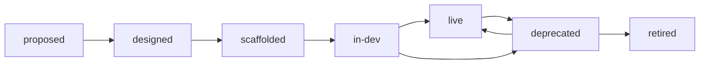

# Project lifecycle

Every project in the platform's record has a phase. A project moves through the phases in order, and each move is checked against entry rules written in Rego. A rejected move lists every rule it failed and leaves the phase alone, and the history keeps it as rejected; an allowed move sets the phase and records the transition with the rule results. See #91.

## Phases

| Phase | Meaning |
| --- | --- |
| `proposed` | The idea is on record; every project starts here |
| `designed` | It has a description (later, an architecture spec) |
| `scaffolded` | At least one repo is linked to it |
| `in-dev` | A pipeline has run on one of its repos |
| `live` | It has an owner and a dashboard, and every repo's default branch is green |
| `deprecated` | It is on its way out |
| `retired` | It has been torn down and archived |

## Moves



A project may move one phase forward, to `deprecated` from `live` or `in-dev`, back to `live` from `deprecated`, and to `retired` only from `deprecated`. Any other move, including one to the phase it is already in or to an unknown phase, fails rule RLP-L101. The moves are a rule, not code, so they are reviewed like any other gate.

## Entry rules

The rules are the `rlp.lifecycle` package of the policy bundle, [`policy/lifecycle/lifecycle.rego`](../policy/lifecycle/lifecycle.rego). A move to a phase is checked against RLP-L101 and that phase's entry rules:

| Id | Target phase | Rule |
| --- | --- | --- |
| RLP-L101 | any | The move is allowed (see Moves) |
| RLP-L102 | `designed` | The project has a description |
| RLP-L103 | `scaffolded` | At least one repo is linked to the project |
| RLP-L104 | `in-dev` | At least one build of a linked repo is on record |
| RLP-L105 | `live` | The project has an owner |
| RLP-L106 | `live` | The project has a dashboard URL. Slice 4 creates dashboards; until then the rule only checks that the record has one |
| RLP-L107 | `live` | The project has a linked repo, and the latest build on each linked repo's default branch passed |
| RLP-L108 | `retired` | The retirement workflow's teardown is on record: every teardown step of the project's retirement succeeded (see [Retirement](#retirement)) |

`deprecated` and `proposed` have no entry rules beyond RLP-L101. The ids are RLP-L1xx because RLP-L001 to RLP-L005 are the bundle's platform-limit rules.

Each failure has the bundle's message form, naming the field that failed:

```text
[RLP-L105] rlp-transition.json project.owner: project "orders" has no owner, which live needs. Fix: set the project's owner.
```

## How a move runs

`rlp_platform.lifecycle.transition(session, project, to, actor, reason)` does the whole move:

1. It builds an `rlp_transition` document from the project record: the project's name, description, owner and dashboard URL, its current and target phase, for each linked repo its default branch, its number of builds and its latest default-branch build, and `teardown`: the retirement's torn-down environments once every teardown step succeeded, else null. The rules read nothing else.
2. It evaluates `data.rlp.lifecycle` with `opa eval`, passing the document on stdin in conftest's combined form (`[{"path": "rlp-transition.json", "contents": {"rlp_transition": ...}}]`), the same input shape `rlp policy check` gives the rest of the bundle.
3. If every rule passed, it sets the project's phase and writes one `lifecycle_transitions` row with the actor, the reason and every rule's result. If any rule failed, it leaves the phase alone and returns the results, failing rules included; when the target is a known phase it also writes a `lifecycle_transitions` row with `accepted` false, so the history shows the rejected attempt and why (`GET .../transitions?include_rejected=true`).

Like the store, it flushes but never commits: the caller owns the transaction. The result lists every rule checked, in order:

```json
[
  {"rule": "RLP-L101", "description": "the move is allowed", "passed": true, "messages": []},
  {"rule": "RLP-L105", "description": "live needs an owner", "passed": false, "messages": ["[RLP-L105] ..."]}
]
```

`POST /api/v1/projects/{name}/transitions` and `rlp lifecycle move` call it; see [platform.md](platform.md).

## Retirement

`rlp lifecycle retire PROJECT` takes a `deprecated` project to `retired`. It tears down the project's infrastructure in every environment, archives its repos, schedules its artifacts to expire, and moves the project to `retired` once each step is recorded. The platform never holds AWS credentials: each teardown runs in the repo's own pipeline, with that pipeline's deploy role.

```sh
rlp lifecycle retire orders            # show the plan; changes nothing
rlp lifecycle retire orders --yes      # start it, or resume it from the first incomplete step
rlp lifecycle retire orders --status   # each step and its status
```

### Steps

A retirement is one record per project (`retirements`) with one row per step (`retirement_steps`), run in order:

| Step | One per | Does | Succeeded when |
| --- | --- | --- | --- |
| `teardown` | linked repo and environment the project has deployments in | dispatches the repo's pipeline workflow (`pipeline.yml`, or `--workflow`) on its default branch with `destroy-env=<env>` ([pipeline.md](pipeline.md#teardown-runs)); the step is `running` until the pipeline reports | every component the repo has deployed in that environment was reported `destroyed` after the dispatch. A `destroy-failed` report, or a refused dispatch, fails the step |
| `archive` | linked repo | archives the repo through the GitHub REST API (`PATCH /repos/{owner}/{repo}`, `archived: true`) | GitHub answered 200 |
| `expire` | project | sets `expires_at` on every artifact of the project to now plus `artifact_retention_days` (`policy/platform/data.yaml`, default 30), never pushing an earlier expiry out | always |

The steps run in order and stop at the first that hasn't succeeded. Every teardown is dispatched at once; archiving starts only when all of them succeeded, so a failed teardown leaves every repo unarchived and the project `deprecated`, with the failed step and its reason in `--status`. Teardowns finish asynchronously, so a retirement takes more than one run of `--yes`: run it again once the pipelines have reported. Each run resumes from the first incomplete step and retries a failed one: a failed teardown is dispatched again, and only a report made after that dispatch counts.

When every step succeeded, the project moves to `retired` through the lifecycle transition, recorded with the actor and reason like any move, and RLP-L108 sees the teardown on record. If an entry rule still refuses, the response carries the rejection and the command exits 1. A project that leaves `deprecated` mid-retirement (moved back to `live`) stops the retirement until it is deprecated again.

`POST /api/v1/projects/{name}/retirement` and `GET .../retirement` are the API behind the command ([platform.md](platform.md)). The command sends `artifact_retention_days` from the CLI's copy of `policy/platform/data.yaml`, so the platform value is reviewed like any other gate.

### Expiring artifacts

`python -m rlp_platform expire-artifacts` deletes every artifact whose `expires_at` has passed and marks it expired (`expired_at`), printing one JSON line with each result. Run it daily, like `sync` ([platform.md](platform.md#sync)), as a scheduled task of the platform image. It is safe to run repeatedly: an artifact already deleted, or found already gone, is marked and never deleted again. It deletes from where `rlp publish` puts artifacts:

- container images on GHCR (`ghcr.io/<owner>/<package>@sha256:...` or `:<tag>`): the package version, through `DELETE /orgs/{owner}/...` or `/users/{owner}/packages/container/{package}/versions/{id}`;
- release assets (`https://github.com/<owner>/<repo>/releases/download/<tag>/<file>`).

Any other reference (an ECR image, for example) is reported `unsupported` and left for a person to delete; one the registry refuses is reported `failed`, left unmarked for the next run, and makes the command exit 1.

### What an administrator grants

The platform's `RLP_GITHUB_TOKEN` (a GitHub App installation token, or a fine-grained token) needs, on every repo it retires:

- **Actions: read and write**, to dispatch the teardown run;
- **Administration: read and write**, to archive the repo;
- for `expire-artifacts`: **Contents: read and write** to delete release assets, and the right to delete the project's GHCR package versions. GitHub grants that to a classic token with `delete:packages` (and admin on the package); a GitHub App installation token can't delete packages owned by a user account, so give `expire-artifacts` its own token if the App can't.

Each repo's pipeline needs what a deploy needs, since the teardown runs as one: the `deploy_role_arn` from the bootstrap (it can destroy what it applied), `tf-state-bucket`, `id-token: write`, and reporting to the platform turned on, without which its teardown never reports and the step stays `running`. The calling workflow must accept the `destroy-env` input ([pipeline.md](pipeline.md#teardown-runs)).

## OPA in the platform

The platform image is built from `platform/`, which can't reach `policy/` at the repo root, so the platform package ships its own copy of the rules in `platform/src/rlp_platform/policy/lifecycle/`. The image's build stage downloads OPA with `python -m rlp_platform.opa`, which pins the same version and SHA256 checksums as the rlp CLI (`cli/src/rlp_cli/tools.py`), and installs it at `/usr/local/bin/opa`. `tests/policy/test_lifecycle_copy.py` fails when the copy, the pins or the image drift apart: after changing `policy/lifecycle/lifecycle.rego`, copy it over the platform's file.

To run the rules by hand from the repo root:

```sh
opa test policy/
echo '[{"path": "rlp-transition.json", "contents": {"rlp_transition": {"project": {"name": "orders"}, "from": "proposed", "to": "live", "repos": []}}}]' \
  | opa eval --format pretty --data policy --stdin-input 'data.rlp.lifecycle.deny'
```

The platform tests evaluate the rules with the `opa` on `PATH`, or download the pinned one for the test session when there is none.
