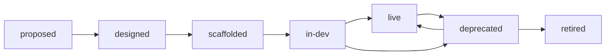

# Project lifecycle

Every project in the platform's record has a phase. A project moves through the phases in order, and each move is checked against entry rules written in Rego. A rejected move lists every rule it failed and changes nothing; an allowed move sets the phase and records the transition with the rule results. See #91.

## Phases

| Phase | Meaning |
| --- | --- |
| `proposed` | The idea is on record; every project starts here |
| `designed` | It has a description (later, an architecture spec) |
| `scaffolded` | At least one repo is linked to it |
| `in-dev` | A pipeline has run on one of its repos |
| `live` | It has an owner and a dashboard, and every repo's default branch is green |
| `deprecated` | It is on its way out |
| `retired` | It has been torn down and archived |

## Moves



A project may move one phase forward, to `deprecated` from `live` or `in-dev`, back to `live` from `deprecated`, and to `retired` only from `deprecated`. Any other move, including one to the phase it is already in or to an unknown phase, fails rule RLP-L101. The moves are a rule, not code, so they are reviewed like any other gate.

## Entry rules

The rules are the `rlp.lifecycle` package of the policy bundle, [`policy/lifecycle/lifecycle.rego`](../policy/lifecycle/lifecycle.rego). A move to a phase is checked against RLP-L101 and that phase's entry rules:

| Id | Target phase | Rule |
| --- | --- | --- |
| RLP-L101 | any | The move is allowed (see Moves) |
| RLP-L102 | `designed` | The project has a description |
| RLP-L103 | `scaffolded` | At least one repo is linked to the project |
| RLP-L104 | `in-dev` | At least one build of a linked repo is on record |
| RLP-L105 | `live` | The project has an owner |
| RLP-L106 | `live` | The project has a dashboard URL. Slice 4 creates dashboards; until then the rule only checks that the record has one |
| RLP-L107 | `live` | The project has a linked repo, and the latest build on each linked repo's default branch passed |
| RLP-L108 | `retired` | The retirement workflow's teardown is on record. The workflow is #96; until it lands, no project can be retired |

`deprecated` and `proposed` have no entry rules beyond RLP-L101. The ids are RLP-L1xx because RLP-L001 to RLP-L005 are the bundle's platform-limit rules.

Each failure has the bundle's message form, naming the field that failed:

```text
[RLP-L105] rlp-transition.json project.owner: project "orders" has no owner, which live needs. Fix: set the project's owner.
```

## How a move runs

`rlp_platform.lifecycle.transition(session, project, to, actor, reason)` does the whole move:

1. It builds an `rlp_transition` document from the project record: the project's name, description, owner and dashboard URL, its current and target phase, and for each linked repo its default branch, its number of builds and its latest default-branch build. The rules read nothing else.
2. It evaluates `data.rlp.lifecycle` with `opa eval`, passing the document on stdin in conftest's combined form (`[{"path": "rlp-transition.json", "contents": {"rlp_transition": ...}}]`), the same input shape `rlp policy check` gives the rest of the bundle.
3. If every rule passed, it sets the project's phase and writes one `lifecycle_transitions` row with the actor, the reason and every rule's result. If any rule failed, it writes nothing and returns the results, failing rules included.

Like the store, it flushes but never commits: the caller owns the transaction. The result lists every rule checked, in order:

```json
[
  {"rule": "RLP-L101", "description": "the move is allowed", "passed": true, "messages": []},
  {"rule": "RLP-L105", "description": "live needs an owner", "passed": false, "messages": ["[RLP-L105] ..."]}
]
```

`POST /api/v1/projects/{name}/transitions` and `rlp lifecycle move` call it; see [platform.md](platform.md).

## OPA in the platform

The platform image is built from `platform/`, which can't reach `policy/` at the repo root, so the platform package ships its own copy of the rules in `platform/src/rlp_platform/policy/lifecycle/`. The image's build stage downloads OPA with `python -m rlp_platform.opa`, which pins the same version and SHA256 checksums as the rlp CLI (`cli/src/rlp_cli/tools.py`), and installs it at `/usr/local/bin/opa`. `tests/policy/test_lifecycle_copy.py` fails when the copy, the pins or the image drift apart: after changing `policy/lifecycle/lifecycle.rego`, copy it over the platform's file.

To run the rules by hand from the repo root:

```sh
opa test policy/
echo '[{"path": "rlp-transition.json", "contents": {"rlp_transition": {"project": {"name": "orders"}, "from": "proposed", "to": "live", "repos": []}}}]' \
  | opa eval --format pretty --data policy --stdin-input 'data.rlp.lifecycle.deny'
```

The platform tests evaluate the rules with the `opa` on `PATH`, or download the pinned one for the test session when there is none.
